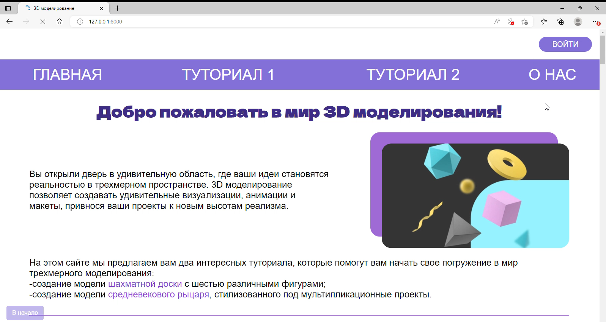
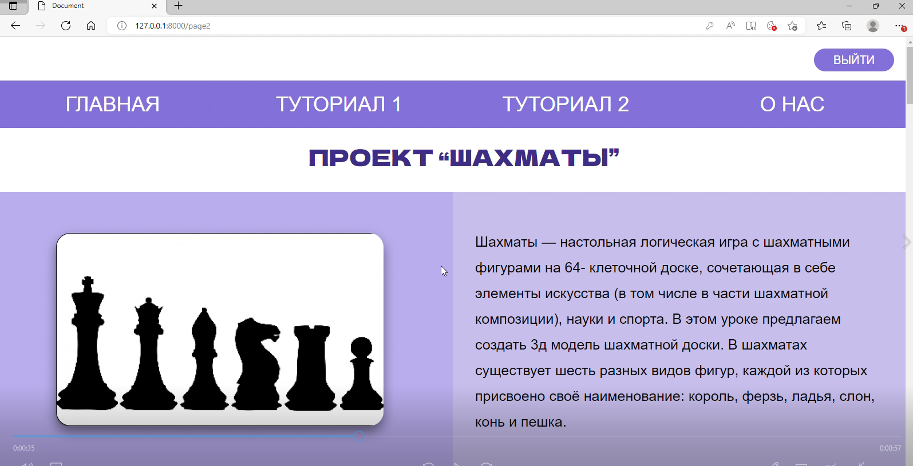
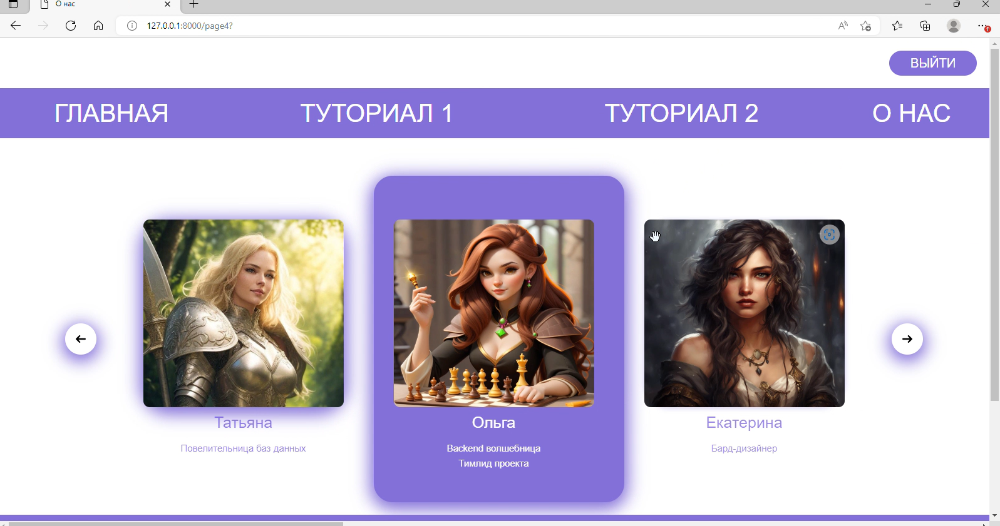
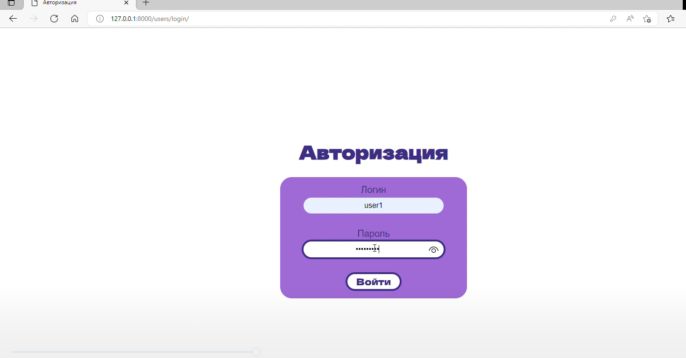
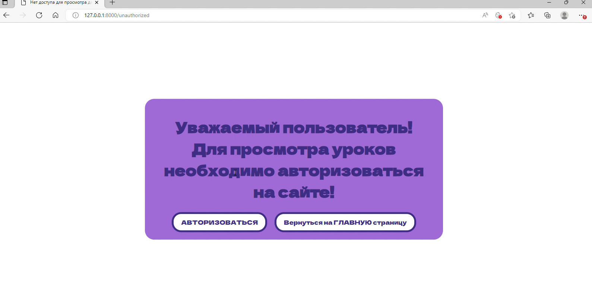

# Многостраничный сайт о 3D моделировании

Этот проект был создан группой из нескольких человек, работающих аналогично команде разработки. Каждый участник имел свою роль в проекте. Я являлась тимлидом проекта и отвечала за разработку backend.

## Планируемые этапы

1. **Планирование:**
   - Определение целей и задач сайта.
   - Разработка структуры сайта и его функциональности.

2. **Дизайн:**
   - Разработка макетов главной страницы и внутренних страниц.

3. **Вёрстка:**
   - Кодирование дизайн-макетов.

4. **Программирование и разработка:**
   - Написание серверной части сайта (backend) на языках программирования.
   - Разработка базы данных.
   - Интеграция серверной и клиентской частей сайта.

5. **Тестирование:**
   - Проведение тестирования функциональности сайта.
   - Проверка кроссбраузерности и адаптивности.
   - Отладка ошибок и исправление дефектов.

## Определение целей и задач сайта

В ходе обсуждения темой нашего сайта было выбрано «3D моделирование».

### Цели сайта:
1. Знакомство пользователя с 3D моделированием как направлением.
2. Получение общих знаний по созданию низкополигональных моделей.

### Задачи сайта:
1. Разработка и изложение уроков, позволяющих пользователям создать конкретные 3D модели.
2. Сбор, структуризация и предоставление информации об актуальности 3D моделирования в различных сферах деятельности.

## Разработка структуры сайта и его функциональности

Предполагается создать многостраничный сайт с основным меню. Обязательными страницами будут: главная страница, страницы с туториалами и раздел о создателях сайта.

- На главной странице будет отражена общая информация по теме сайта, а также приведены полезные ссылки на внешние ресурсы для ознакомления пользователей с интересной и полезной информацией о 3D моделировании.
- На страницах с туториалами будут представлены пошаговые уроки, сопровождаемые скриншотами, по конкретной модели или группе моделей.
- В разделе «О нас» будет представлена краткая информация о создателях сайта.
- Сайт будет поддерживать функцию авторизации и проверки пользователя. Страницы с туториалами будут доступны только авторизованным пользователям.

## Дизайн

Были разработаны начальные макеты всех трех типов страниц данного сайта. А также принято решение использовать сине-фиолетовую гамму цветов для сайта, поскольку была выявлена ассоциация именно этой палитры со сферой 3D-моделирования. 

## Выбор инструментов
Для веб-приложения, охватывающего обе стороны веб-разработки (бэк и фронт), оптимальными инструментами для поставленных целей были выбраны веб-фреймворк Django (Python) в связке с компонентами БД, html и css.

## Скриншоты
Вот несколько скриншотов страниц нашего сайта:

